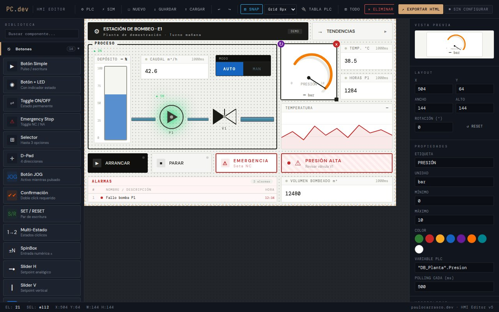

# HMI Editor

Visual editor for industrial HMI screens that runs entirely in the browser. Drag components onto a canvas the size of a real operator panel, bind them to PLC tags, test them with the built-in signal simulator and export a standalone HTML screen that talks to a Siemens S7-1200/1500 PLC through its Web API.

**Live demo:** [paulocarrasco.dev/projects/hmi-editor](https://paulocarrasco.dev/projects/hmi-editor/). There is no PLC behind it, so use **⚡ SIM** to simulate signals.



## Features

- **209 components in 19 categories**: buttons, displays, gauges, trends, alarm lists, P&ID symbols (pumps, valves, tanks, pipes), motors and drives, sensors, safety devices, navigation and decoration.
- **Real panel sizes**: Siemens Comfort panels from 7" (800×480) to 21.5" (1920×1080).
- **Editing**: snap grid, multi-selection, align and distribute, layers, rotation, copy and duplicate, context menu, undo/redo and keyboard shortcuts.
- **PLC binding**: each component maps to tags such as `"DB1".Motor_Run`. A project can use several PLCs, each with its own IP, credentials and colour, and the connections table can be exported as CSV.
- **Popups**: buttons that open floating detail panels, designed in their own editor.
- **Simulator**: switch signals on and off and watch the components react (running pump, active alarm…) without any hardware.
- **HTML export**: generates a single HTML file with the screen and a JavaScript runtime that reads and writes tags through the S7 Web API (JSON-RPC over HTTPS: `Api.Login`, `PlcProgram.Read`, `PlcProgram.Write`).
- **Projects** are saved and loaded as JSON files; nothing leaves the browser.

## The exported runtime

The generated screen is meant to run unattended on a shop-floor panel, so the connection layer is defensive:

- a serialized request queue (one request in flight to the PLC) with reads batched per polling tick;
- a login mutex so parallel logins don't invalidate each other, and no logout on reconnect, so other clients' sessions survive;
- silent token renewal, and reconnection with exponential backoff (capped at 4 s) that only starts after consecutive failures;
- random start-up jitter to avoid login storms when several panels boot at the same time.

## How it's built

- Vanilla JavaScript, HTML and CSS: no framework, no build step and no dependencies.
- About 18,000 lines split into modules that load in numeric order (state, drag and drop, rendering, selection, move and resize, guides, alignment, layers, properties, history, PLC configuration, project I/O, HTML generator, simulator…).
- Styles split by area: layout, library panel, each component family and the PLC state animations.

## Run it locally

Nothing to install. Clone the repository and open `index.html`, or serve the folder:

```bash
git clone https://github.com/P542-X/HMI-Editor.git
cd HMI-Editor
python3 -m http.server 8000
```

Then go to <http://localhost:8000>. The editor interface is in Spanish.

## Project structure

```
index.html                 editor layout and component library
css/                       styles by area (01 layout … 12 PLC animations, 13 demo dialog)
js/                        modules, loaded in numeric order
  01_estado-global.js        global state, component defaults and sizes
  04_html-interior.js        how each component is drawn in the editor
  12_propiedades.js          properties panel
  17_plc.js, 28_multi-plc.js PLC connections
  18_proyecto.js             save and load projects
  20_generador-html.js       HTML export and PLC runtime
  23_plc-simulador.js        signal simulator
  29_popup-editor.js         popup editor
  30_demo.js                 sample screen and welcome dialog of the public demo
```

## License

Free to use, study, modify and share. **You may not sell it**, nor sell a modified version or a paid service whose value comes mainly from it. See [LICENSE](LICENSE): MIT with the Commons Clause condition.

## Author

Paulo Carrasco · [paulocarrasco.dev](https://paulocarrasco.dev) · [LinkedIn](https://www.linkedin.com/in/paulocarrasco542)
